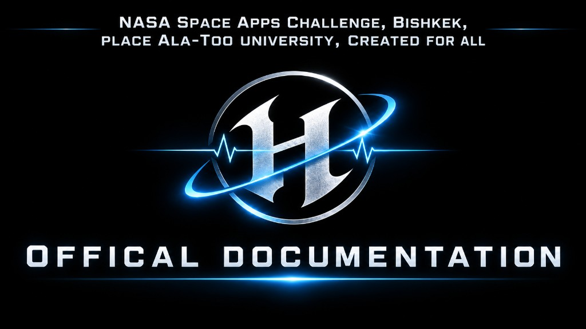

<p align="center">
  
</p>

<p align="center">
  
  
  
  
  
  
  
  
</p>

## Install on this Windows computer

The block below starts `HE-Installer\HE-Installer.exe`, the setup program for this Windows user. It opens the Health Engine Setup window. Records already stored on the computer stay in place. From the project folder, copy the command and paste it into PowerShell.

```powershell
powershell -ExecutionPolicy Bypass -File .\HE-Installer\Install-HealthEngine.ps1
```

Add `-Silent` to install without the window. Add `-Prefix` and a folder path to choose where the program files go.

# Health Engine

Offline desktop program for crew health checks on the computer where it is installed. A space station and a lunar base use the same rule: after the software is on that computer, camera checks, records, reminders, and exports work with no network.

This is a screening-support tool. It does not diagnose, prescribe, or decide fitness for duty.

## What this version does

- Opens a local window with mission UTC, day of year, mission elapsed time, and a configurable circadian window.
- Stores crew profiles, camera pulse attempts, journal entries, tasks, alerts, and an audit trail in SQLite.
- Runs face pulse estimation in a local Python process. A pulse number is saved only when the experimental quality gates pass.
- Reports the camera format the driver actually delivered.
- Keeps records on this computer. Nothing is marked synchronized, because no ground link is configured.
- Exports JSON or TXT, writes a monthly snapshot folder, and can copy the database to a local backup.

## What this version does not do

- It does not embed Python inside the installer yet. On a crew computer the Python environment must already sit in `python-worker/.venv`, or `HEALTH_ENGINE_PYTHON` must point at the bundled interpreter.
- It does not send data to Earth, speak a satellite protocol, or require an account login.
- It does not grade a pulse number as healthy or unfit. No screening thresholds are approved.
- It does not offer finger measurement, demo records, or PDF export.
- It does not claim the camera is uncompressed or running at a requested frame rate unless the driver reports that.

## Data on this computer

Windows: `%LOCALAPPDATA%\HealthEngine`

- `database\health_engine.sqlite` is the record.
- `logs\python-worker.log` is the vision process log.
- `exports\` holds selected JSON or TXT files.
- `backups\` holds database copies made from Settings.
- `ASTRONAUTS-HEALTH-RESULTS-MONTH\YYYY-MM\` holds monthly snapshot files. Those files are copies. The database remains the record.

The program does not delete health records during normal use.

## Run it here

```powershell
npm install
powershell -ExecutionPolicy Bypass -File scripts\bootstrap-windows.ps1
npm run tauri dev
```

The bootstrap step needs a network once, to create the local Python environment. After that, measurement and storage do not use the network.

On this computer the system drive is nearly full. Build the Rust shell onto another drive:

```powershell
$env:CARGO_TARGET_DIR = "D:\HealthEngine-build\cargo-target"
npm run tauri dev
```

Checker commands:

```powershell
python-worker\.venv\Scripts\python.exe -m pytest
cargo test --manifest-path src-tauri\Cargo.toml
npm run build
```

## Controlling documents

Product behavior comes from `docs/technical-specification.txt`. The system shape comes from `docs/architecture-document.txt`. If they disagree, the technical specification wins. The first prototype report is evidence from an experiment, not a second specification.

## Acknowledgement

Thank you to the NASA Space Apps Challenge for the opportunity to build this project in Bishkek, at Ala-Too University, for everyone.
